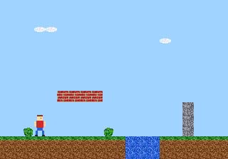

# neogeo-asset-starter

A small asset pipeline for Neo Geo homebrew made with
[ngdevkit](https://github.com/dciabrin/ngdevkit). It turns images and
[Tiled](https://www.mapeditor.org/) maps into C-ROM tiles and C headers, so
your code uses names like `GFX_HERO` instead of raw tile numbers.



## Run the demo

You need [uv](https://docs.astral.sh/uv/), ngdevkit and MAME.

```bash
cd Cartridge
```

```bash
make
```

```bash
make mame
```

## How it works

- `Tools/process_graphics.py` cuts every `.png` and `.gif` in a folder into
  16×16 tiles, in the order `tiletool.py` writes them. Each tile gets its own
  palette, shared with other tiles when the colours fit, so artists paint
  normal images. It writes `Graphics.h/.c`: the first tile, size, frame count
  and tile palettes of every image.
- `Tools/process_maps.py` turns Tiled maps into `Maps.h/.c`, stored column by
  column to match the Neo Geo's vertical sprite strips.
- When an asset cannot work on the hardware, the build stops and says which
  file and what to fix.
- `Cartridge/main.c` shows how to load the palettes and draw a map and an
  animated sprite.

## Tiled setup

- Save maps as JSON (`.tmj`) with **Tile Layer Format** set to **CSV**.
- Keep the tileset in its own `.tsx` file: one per map, 16×16 tiles, its
  image in the graphics folder.
- A named point object such as `player_start` becomes
  `MAP_LEVEL1_PLAYER_START_X` and `_Y`.

## Use it in your own project

In a copy of ngdevkit's `00-template`, with this repo next to it, add this
to the `Makefile` after `include emu.mk`:

```make
STARTER = ../neogeo-asset-starter
ASSET_FIRST_TILE = 256
include $(STARTER)/Make/assets.mk
CFLAGS += -I$(ASSET_GENERATED_DIR)
```

Then change the `$(ELF):` line, and add your tiles below the template's own
C-ROM lines:

```make
$(ELF):	$(BUILDDIR)/main.o $(ASSET_OBJECTS)
$(BUILDDIR)/main.o: $(ASSET_HEADERS)
$(CROM1): $(GRAPHICS_C1)
$(CROM2): $(GRAPHICS_C2)
```

Images go in `art/`, maps in `maps/`. The first tile is 256 because the
template's logo fills tiles 0 to 255.

## Licence

MIT. The demo art is placeholder art made for this repo.
